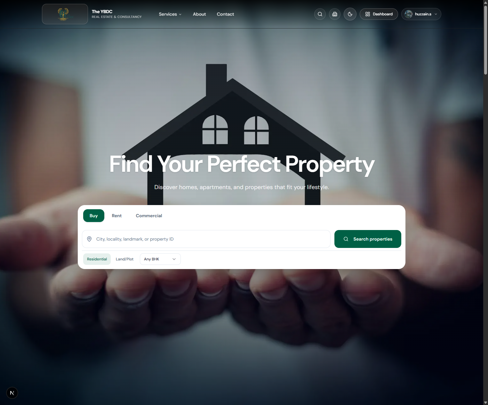
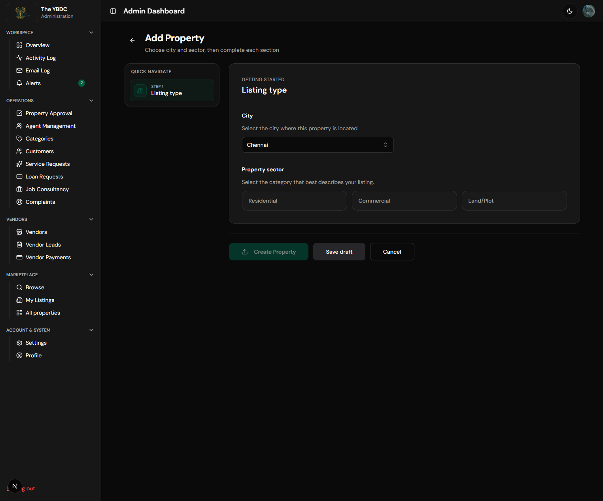
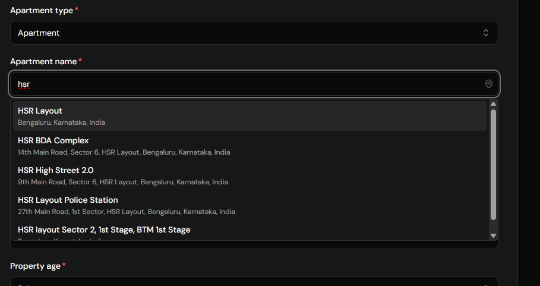
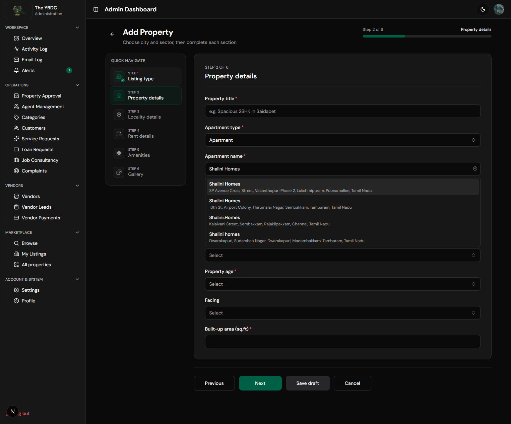

# Update for client — Apartment name search (Add Property)

**Product:** The YBDC  
**Area:** Add Property → Property details → Apartment name  
**Status:** Fixed and verified  

---

## Summary (for WhatsApp / email)

We upgraded **Apartment name** so owners can search societies with **Google Places**, limited to the **city chosen in step 1** (Chennai or Bengaluru). Results are cached on the server (~3 weeks) to control API cost. Selecting a society can also help fill map location when empty.

---

## What was wrong

1. Apartment name was a plain text box (no search).
2. Early search attempts either returned **no list**, or suggested places in the **wrong city** (e.g. Chennai selected but Bengaluru “HSR” results appeared).

---

## What we fixed

| Item | Detail |
|------|--------|
| Searchable apartment / society name | Type to see Google Places suggestions |
| City-scoped results | Uses the city from Listing type (Chennai / Bengaluru) |
| Wrong-city results removed | Hard location limit + filter so Bengaluru hits do not show for Chennai (and vice versa) |
| Cost control | Server Places API + ~3 week cache for the same search |
| Secure key setup | Dedicated server key with **Places API (New)** only (not the public browser key) |

---

## How to try it

1. Open **Add Property**.
2. Select **City** (e.g. Chennai) → Residential → Rent → Next.
3. On **Property details**, set **Apartment type** = Apartment.
4. In **Apartment name**, type a society (e.g. *Shalini Homes*).
5. Pick a suggestion from the list (addresses should match that city).

---

## Screenshots

### 0. Site home (localhost)

### 1. City selected first (Chennai)

City is chosen on Listing type before property details. Search uses this city.

### 2. Before the fix — wrong city in suggestions

With Chennai intended, searching “hsr” incorrectly showed **Bengaluru / HSR Layout** results.

### 3. After the fix — Chennai + “Shalini Homes”

Suggestions stay in the Chennai / Tamil Nadu area (e.g. Poonamallee, Tambaram, Sembakkam).

---

## Note for your team

- Free typing of a custom apartment name is still allowed if nothing is picked from the list.
- Please keep the server Maps key private (server env only). Restrict by IP in production when possible, and keep a Google Cloud billing alert on.

---

*Prepared for client handoff — The YBDC Add Property apartment search update.*
